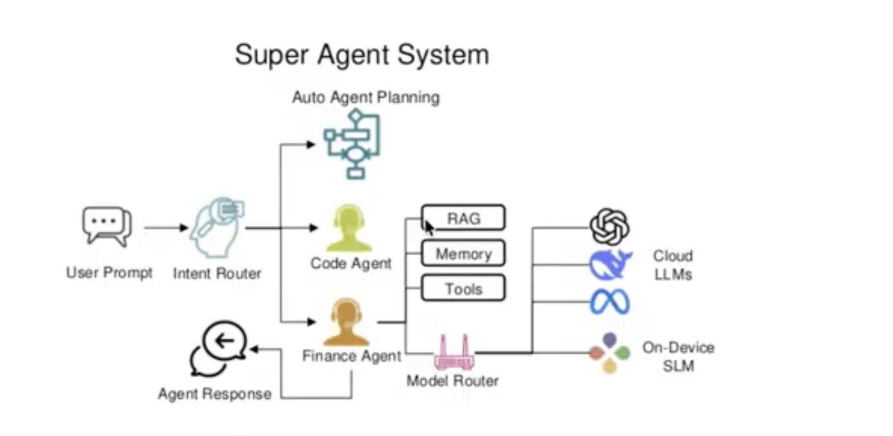

# Личный ассистент · учебный проект по курсу «AI-агенты»

Проект команды из четырёх человек. Подготовлена React-оболочка с боковым меню в стиле SecondBrain и первая общая служба поиска трендов; функциональность предметных модулей уточняется.

Идея — личный ассистент, объединяющий данные и дела из разных сфер жизни. Основной принцип: максимально используем детерминированные автоматизации и добавляем AI только для задач, которые ими не покрываются.

Репозиторий: [Assirisss/ai-agents-hse](https://github.com/Assirisss/ai-agents-hse).

**Дела и календарь · Финансы и инвестиции · Спорт и питание · Гардероб**

Планируем собственный сайт и взаимодействие через Telegram. Для проверки используем одинаковые данные. Утренний отчёт оставляем дополнительной функцией; тренды рассматриваем как общую возможность для разных разделов.

## Документация

- [Frontend: запуск и работа над своим модулем](frontend/README.md) — React + TypeScript + Vite, отдельная папка для каждого блока.
- [Backend: API поиска трендов](backend/README.md) — запуск, контракты и подключение к другим агентам.
- [Поиск трендов: алгоритм и границы](docs/trends.md) — источники, рост упоминаний, обзор материалов и необязательный AI-разбор.
- [Исследователь: лучшие практики, проверка оснований и evals](docs/trends-agent-practices.md) — план, свежесть, цитаты, прогресс и отмена.
- [Чат трендов и детерминированные инструменты](docs/trend-chat.md) — диалоги, параметры, фильтры, сравнение и закладки.
- [Graphite: оформление](design/BRAND.md) — визуальные правила и расположение из SecondBrain.
- [Описание идеи](docs/vision.md) — проблема, пользователи, сценарии и границы проекта.
- [Карта функций](docs/product-map.md) — четыре блока, автоматизации, кандидаты для AI и открытые вопросы.
- [Варианты архитектуры](docs/architecture.md) — сравнение одного агента, диспетчера со сценариями и системы с делегированием; предлагаемая схема.
- [Вопросы для обсуждения](docs/discovery.md) — последовательность обсуждения и открытые вопросы.
- [Журнал решений](docs/decisions.md) — согласованные решения и их причины.

## Как работаем над идеей

1. Обсуждаем один блок вопросов за раз, начиная с проблемы и пользователя.
2. Фиксируем ответы в документах. Предположения явно отмечаем и проверяем.
3. Описываем конкретный пользовательский сценарий от входных данных до результата.
4. Выбираем небольшой MVP и определяем, как проверить его качество.
5. Рисуем схемы пользовательского сценария, работы агентов и компонентов системы в Mermaid.
6. Выбираем архитектуру и разбиваем MVP на задачи с понятным результатом и условиями приёмки.
7. Согласуем интерфейсы между частями системы и распределяем работу между четырьмя участниками.

На следующих этапах добавим требования, архитектуру, инструкции запуска и задачи. Каждая задача должна содержать контекст, входные и выходные данные, зависимости и условия готовности, чтобы участник команды мог работать над ней со своим AI-агентом.

## Статус

Согласованы четыре продуктовых блока и каналы взаимодействия. Создан frontend на React + TypeScript + Vite. Общий поиск трендов доступен через экран, HTTP API и инструмент `search_trends` для будущего оркестратора. Backend этой службы — Node.js + TypeScript + Fastify. Добавлены профиль, контекст разделов, SQLite-память, веб-поиск, Crossref и выбор инструментов через OpenRouter или Ollama. Обязательных платных API нет; по умолчанию для OpenRouter используется бесплатный маршрут. Агентная архитектура остальных областей и состав первой демонстрации уточняются.

## Быстрый запуск

Node.js 24 LTS и npm. В первом терминале из корня репозитория:

```sh
cd backend
npm ci
npm run dev
```

Во втором терминале из корня репозитория:

```sh
cd frontend
npm ci
npm run dev
```

Откройте адрес, который напечатает Vite, обычно `http://localhost:5173`. Поиск трендов находится в боковом меню «Инструменты»: можно выбрать явно обозначенный демонабор или живые RSS-источники и поиск в интернете. Профиль, контекст разделов и память доступны на том же экране; вызовы модели включаются отдельно.

Дела и календарь — `frontend/src/modules/planning/`, финансы — `finance/`, спорт и питание — `health/`, гардероб — `wardrobe/`. Общий экран поиска — `trends/`; типы интеграции — `shared/trends.ts` в корне проекта. [Подробности для команды](frontend/README.md).

## Архитектурный референс



Скриншот предоставлен автором проекта; оригинальный источник не установлен. Это референс для обсуждения, а не схема реализованной системы. [Разбор применимости и предлагаемая архитектура](docs/architecture.md).
