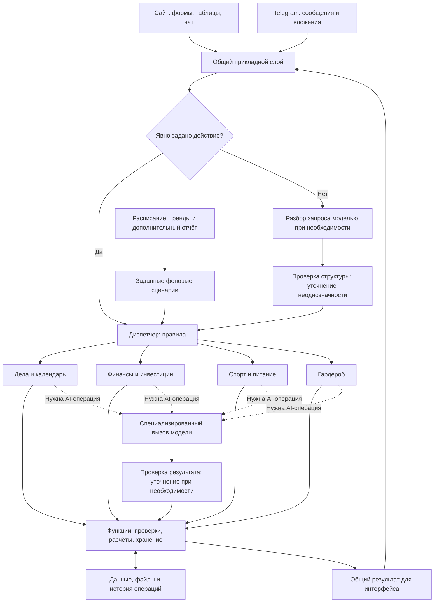

# Архитектура · варианты для обсуждения

> **Статус: предложение, не принятое решение.** Состав продукта согласован на уровне четырёх блоков; архитектурный вариант ещё выбираем. Стек и агентный фреймворк не выбраны.

## Референс автора

Скриншот `Screenshot 2026-10-16 at 3.18.57 PM` добавлен по просьбе автора проекта. Оригинальный источник схемы не установлен. Это внешний референс, а не схема реализованной системы.

На изображении различаются несколько ролей:

| Элемент | Роль | Применение к нашему проекту |
| --- | --- | --- |
| **Intent Router** | Направляет запрос по назначению. | Полезна сама роль диспетчера; явные действия сайта можно направлять обычным кодом. |
| **Auto Agent Planning** | Планирует выполнение задачи с помощью модели. | Кандидат только для задач, где фиксированная последовательность недостаточна. |
| **Специализированные агенты** | Выполняют работу в своей области. | Можно начать со специализированных модулей и сценариев; автономность каждого ещё нужно обосновать. |
| **RAG** | Находит контекст для ответа модели. | Поиск по сохранённым материалам при появлении такого сценария. Это не диспетчер и не судья. |
| **Memory** | Сохраняет нужный контекст. | Начинаем с явных записей, настроек и истории в хранилище. Дополнительная агентная память пока не обоснована. |
| **Tools** | Предоставляют действия и получение данных. | Функции четырёх модулей с проверяемыми входами и выходами. |
| **Model Router** | Выбирает модель. | Возможен выбор обработчика по типу задачи: текст, фото еды, чек, изображение одежды. Динамический LLM-выбор модели пока не нужен. |

Термин «Jag-судья» из обсуждения нужно уточнить. Если речь о распределении заданий, это роль диспетчера/оркестратора. Если об оценке качества результата — отдельная роль оценщика. Их не объединяем автоматически.

## Три варианта

| Вариант | Как работает | Что получаем | Ограничения |
| --- | --- | --- | --- |
| **A. Один агент с инструментами** | Одна LLM выбирает инструменты всех четырёх модулей. | Один разговорный вход, небольшое число агентных ролей. | Нужно ограничивать доступные инструменты и контекст; обычные операции не стоит пропускать через LLM. |
| **B. Диспетчер и специализированные сценарии** | Явные действия маршрутизирует код; свободный запрос при необходимости разбирает модель. Дальше работают обычные функции и отдельные вызовы AI. | Проверяемые пути выполнения и разделение четырёх областей; соответствует принципу автоматизации. | Сложный непредвиденный запрос может потребовать дополнительного планировщика. |
| **C. Главный агент и агенты областей** | Главная LLM разбивает запрос на задания, передаёт их агентам областей и собирает ответ. | Подходит для задач с заранее неизвестным разбиением и последовательностью работы. | Дополнительные вызовы, обмен контекстом, ошибки делегирования и сложность проверки; пользу нужно измерить. |

**Рекомендация для старта: вариант B.** Модули проектируем так, чтобы их функции могли использоваться обычным интерфейсом, обработчиками Telegram и будущими агентами. Число агентов не привязываем к четырём участникам команды.

Это проектная рекомендация. Её основание: большая часть уже описанных сценариев имеет известный порядок действий, а маршрутизация сама по себе не требует автономного агента. В руководстве Anthropic различаются фиксированные workflows, routing и динамическое делегирование orchestrator-workers; рекомендуется усложнять систему по мере подтверждения необходимости: [Building effective agents](https://www.anthropic.com/engineering/building-effective-agents).

## Предлагаемая схема

Сайт и Telegram используют одну прикладную логику. Разделение Telegram-пользователей, привязка аккаунтов и физическая организация хранилища ещё не выбраны.

Операции интерфейса, расписания и подтверждённые команды должны оставаться выполнимыми без LLM там, где она не нужна. Ошибки распознавания не должны превращаться в непроверенные суммы, даты или записи.

## Примеры выполнения

### Чек

Фото → извлечение полей подходящим обработчиком → проверка суммы, валюты и повторной загрузки → категория по правилам либо предложение модели → уточнение спорных полей → запись операции → пересчёт баланса обычным кодом.

Необходимость подтверждения каждой записи пользователем пока обсуждается. Начальный баланс и смысл приходов/расходов нужно определить до расчёта доступных денег.

### Тренировка и следующий план

Сообщение → извлечение упражнений, подходов, нагрузки и самочувствия → проверка полей → запись → расчёт динамики → шаблон следующей тренировки по правилам или AI-предложение, если есть нерешённая задача.

Сначала нужно определить критерии «лучше/хуже»: сравнивать произвольные тренировки по одному числу некорректно.

### Тренды

Расписание → загрузка из выбранных источников → устранение повторов и фильтры → тематический обзор моделью при необходимости → сохранение ссылок и времени публикации/получения → показ в нужном разделе.

Для этого фиксированного процесса постоянно работающий автономный агент пока не требуется. Отдельный агент станет кандидатом, если потребуется самостоятельно выбирать источники, менять план поиска и оценивать достаточность найденного.

## Когда добавляем агента или оркестратора

1. Есть конкретный запрос, который известные сценарии не покрывают.
2. По ходу выполнения нужно выбирать инструменты или подзадачи на основании промежуточного результата.
3. Один агент с ограниченным набором инструментов проверен как более простой вариант.
4. Делегирование нескольким агентам показывает пользу на одинаковых тестовых данных.

Для нескольких областей сначала пробуем явную композицию функций через общий прикладной слой. При добавлении агентов используем те же контракты инструментов; произвольные беседы агентов друг с другом не являются исходным требованием.

## Проверка на одинаковых данных

Предлагаем подготовить общий демонстрационный набор: проекты и события, операции и чеки, тренировки, фотографии еды и одежды. Фиксируем исходное состояние, примеры запросов и ожидаемые изменения; между прогонами восстанавливаем исходное состояние.

Сравниваем простой сценарий, один агент и мультиагентный вариант только на одних и тех же применимых задачах. Показатели: корректность полей и изменений, успешность задачи, число уточнений, время, число вызовов и стоимость. Одинаковые входы не гарантируют одинаковых ответов LLM; результаты и версии настроек сохраняем.

«Судья» для оценки свободного текста может быть дополнительным инструментом проверки, но суммы, даты, балансы и схемы данных проверяет код. Независимую LLM-оценку имеет смысл вводить после определения критериев, а не вместо них.
