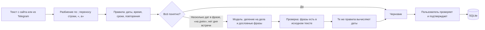
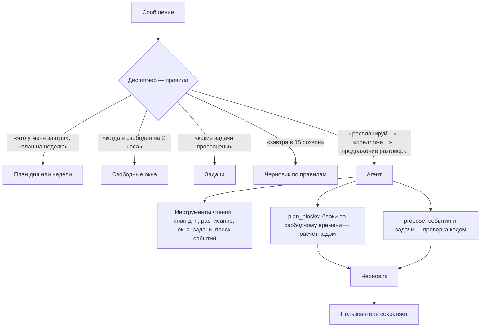

# Дела и календарь · устройство раздела

> Статус: первая версия реализована. Модель данных, синхронизация, сводка, Telegram и разбор текста работают; ограничения перечислены ниже.

## Что умеет

| Возможность | Как сделано | AI |
| --- | --- | --- |
| События, задачи, повторения, обязательства фирмы | Собственная база SQLite; повторения по RRULE (iCalendar), у повторяющейся задачи после выполнения создаётся следующая | Нет |
| План на день | Пересечения, свободные окна в рабочие часы, просроченное, оценка перегрузки по длительностям задач | Нет |
| Google Календарь | OAuth 2.0 и Calendar API v3, двусторонняя синхронизация | Нет |
| Яндекс Календарь | CalDAV (RFC 4791) с паролем приложения, двусторонняя синхронизация | Нет |
| Telegram | Утренний план, напоминания о событиях и сроках, команды, добавление текстом с подтверждением кнопкой | Только разбор сложного текста |
| Ввод свободным текстом | Правила для русских дат; модель только делит сложную фразу на дела и дословно цитирует фразы о времени | Только при конкретной причине |
| Ассистент (сайт, Telegram, оркестратор) | Диспетчер на правилах отвечает на простые вопросы; агент с инструментами — на просьбы спланировать | Только агент, для сложных запросов |

## Принцип: правила → модель только для остатка

- Модель не вычисляет даты. Небольшие локальные модели ошибаются в арифметике дат, поэтому они возвращают только цитаты вроде «в пятницу в 11», а дату считает код.
- Цитата, которой нет в сообщении, отбрасывается с пометкой в «Как разобрано».
- Без подтверждения пользователя ничего не записывается. В записи остаётся источник: `parser` (правила) или `ai` (модель). Так видно, насколько можно доверять каждой записи.
- Черновик показывает допущения, например «„в 3“ понято как 15:00» или «длительность не указана — 1 час».
- Без модели раздел полностью работает на правилах.
- Кнопка «✦ Моделью» (и «Переразобрать моделью» в черновике, `/ai текст` в Telegram, `force: true` в API) отправляет в модель весь текст, даже если правила справились. Даты по-прежнему вычисляют правила. Режим нужен, когда правила поняли фразу не так, и для сравнения «правила против модели» на одних данных.

Модель: `PLANNING_LLM_MODEL` (или `TREND_LLM_MODEL`) — локальная Ollama, проверено на `qwen3:8b`. Без локальной модели используется OpenRouter при наличии ключа. `PLANNING_LLM=off` выключает модель.

## Ассистент: диспетчер и агент

- **Диспетчер** (`dispatch` в `backend/src/planning/agent.ts`) — обычный код. План, неделя, свободное время, задачи и новые дела обходятся без модели: так отвечает большинство запросов, за миллисекунды.
- **Агент** нужен, когда последовательность шагов заранее неизвестна: «распланируй подготовку к экзамену: 6 часов до пятницы», «предложи время для встречи в среду или четверг», «а можно не больше одного блока в день?». Модель сама выбирает инструменты по промежуточным результатам.
- **Инструменты агента:** `get_day_plan`, `get_agenda`, `find_free_slots`, `list_tasks`, `search_events` (только чтение), `plan_blocks` и `propose` (только черновик).
- **Что считает код, а не модель.** Даты модель берёт из готового календаря на 14 дней в контексте; срок можно передать словами («до пятницы»), его переводит парсер. Блоки по свободным окнам расставляет `plan_blocks`. Прошедшее время, рабочие часы и пересечения проверяет `propose`. Так сделано по итогам живых прогонов: `qwen3:8b` складывал часы неверно (12 вместо 6) и путал дни недели.
- **Границы:** 8 шагов модели, 14 вызовов инструментов, 3 черновика, 150 секунд. На последнем шаге инструменты недоступны, модель обязана ответить. Ошибка аргументов возвращается модели, и она исправляется.
- **Сохраняет только пользователь.** Агент не может создать, изменить или удалить запись; черновик подтверждается той же кнопкой, что и любой другой. Источник записи — `ai`.
- **Без модели** диспетчер работает полностью, а на просьбы спланировать ассистент объясняет, что нужна модель.

Доступ: вкладка «Ассистент» на сайте, обычные сообщения и `/ask` в Telegram, `POST /api/planning/assistant`, инструмент `planning_assistant` для оркестратора. История разговора — последние 6 реплик: на сайте в рамках страницы, в Telegram в памяти сервера в течение 30 минут.

## Двусторонняя синхронизация

Алгоритм общий для обоих провайдеров (`backend/src/planning/sync.ts`), отличаются только клиенты.

1. Загружаются события календаря в окне «30 дней назад — 365 дней вперёд».
2. Изменение на стороне календаря определяется по смене ETag, локальное — по `updatedAt > syncedAt`.
3. Если событие изменилось в обоих местах, остаётся версия с более поздним временем изменения. Конфликт записывается в журнал синхронизации на вкладке «Подключения».
4. Если связанного события нет в ответе, оно запрашивается напрямую. Удалённым оно считается только при 404/410, а не просто потому, что вышло за окно.
5. Локальные удаления хранятся как метки удаления, пока не будут отправлены в календарь.
6. Записи идут с `If-Match`, поэтому одновременная правка вызывает 412 и не перезаписывает чужие изменения.
7. В CalDAV при обновлении меняются только поля мастер-события в исходном ресурсе. Исключения серии, участники и чужие свойства сохраняются. В Google используется `PATCH`.

Синхронизация запускается каждые `syncIntervalMinutes` минут, через 1,5 с после локального изменения и по кнопке.

Куда попадают новые события: при подключении аккаунта или включении синхронизации календаря он становится календарём для новых событий, если такой ещё не выбран. Выбор можно сменить на вкладке «Подключения», в том числе на «только в этом приложении». События, созданные до выбора календаря, остаются локальными; кнопка «Отправить в …» переносит их в календарь. Задачи во внешние календари не отправляются.

Особенности CalDAV Яндекса, учтённые в клиенте: событие хранится как `<UID>.ics` независимо от имени при загрузке, поэтому имя ресурса сразу совпадает с UID, а при расхождении ресурс ищется по UID; сжатые ответы получают ETag с суффиксом `--gzip`, поэтому запросы идут без сжатия. Если событие с нашим UID оказалось по другому адресу, синхронизация переносит связь, а не создаёт дубль.

## Данные доступа

Пользователь вводит всё в интерфейсе («Подключения»), инструкции встроены туда же:

- **Google**: свой OAuth-клиент типа Web application и адрес возврата `PLANNING_PUBLIC_URL/api/planning/google/callback`. В тестовом режиме Google доступ действует 7 дней, потом аккаунт получает статус «нужно переподключить».
- **Яндекс**: логин и пароль приложения «Календарь (CalDAV)»; CalDAV-ссылка календаря необязательна. Запросы разрешены только к `caldav.yandex.ru`.
- **Telegram**: бот общий для проекта. Его токен задаётся на сервере (`TELEGRAM_BOT_TOKEN` в `backend/.env`), и бот запускается вместе с сервисом; создавать своего бота пользователю не нужно. Пользователь только привязывает чат одноразовой ссылкой, которая действует 15 минут; непривязанные чаты данных не получают. Если переменная не задана, токен своего бота можно вставить на сайте.

Секреты хранятся в `backend/data/planning.sqlite` под AES-256-GCM. Ключ лежит в `backend/data/planning.key` (права 0600) или задаётся через `PLANNING_SECRET_KEY`. Каталог `backend/data/` исключён из Git.

## Telegram

Бот общий для проекта (`backend/src/telegram/`): другие разделы регистрируют свои команды в `TelegramRouter`. Он запускается вместе с сервисом по `TELEGRAM_BOT_TOKEN`; если при старте нет сети, повторяет попытку каждые 30 секунд. Работает через long polling, публичный адрес не нужен.

Один токен может опрашивать только один запущенный backend. Если двое участников запустят сервис с одним и тем же токеном, Telegram вернёт конфликт и сообщения будут доходить лишь до одного из них. Для разработки каждому нужен свой тестовый бот, а токен бота проекта — только на сервере демонстрации.

| Команда | Что делает |
| --- | --- |
| обычный текст | Ассистент: на вопросы о плане отвечает сразу, новые дела превращает в черновик, просьбы спланировать передаёт агенту |
| `/add текст` | Черновик с кнопками «Сохранить» и «Отмена»; если чего-то не хватает, следующее сообщение дополняет запрос |
| `/ask текст` | Сразу агент |
| `/ai текст` | То же, но текст разбирает модель, даже если правила справились бы |
| `/today`, `/tomorrow`, `/week` | План на день или неделю |
| `/tasks` | Открытые задачи с кнопками «✓» |
| `/sync` | Синхронизировать календари |
| `/unlink` | Отвязать чат |

Уведомления: план на день в `briefTime`; если сервер запустился позже, план отправляется в пределах 3 часов. Напоминания о событиях и сроках задач приходят за заданное число минут. Журнал отправленного исключает дубли после перезапуска. Напоминание, пропущенное во время простоя больше чем на 15 минут, не досылается.

## Интеграция с остальной системой

- HTTP API: `/api/planning/*`, список — в [инструкции backend](../backend/README.md).
- Инструменты для оркестратора (`backend/src/planning/tool.ts`): `planning_assistant`, `planning_day_brief`, `planning_find_free_slots`, `planning_draft_from_text`. Черновик ничего не сохраняет.
- Контекст для «Поиска трендов»: только счётчики (`/api/planning/context`), без названий и заметок.
- Текст сводки (`DayBrief.text`) годится для будущего утреннего отчёта.

## Ограничения

- Уведомления и синхронизация работают, пока запущен backend: развёртывание проекта не выбрано.
- Перенос события между внешними календарями не поддерживается; нужно создать событие в нужном календаре.
- Изменённые отдельные повторения серии Яндекса доступны только для чтения; в Google их можно править.
- Для повторяющихся событий с часовым поясом в CalDAV передаётся упрощённый VTIMEZONE с текущим смещением. Это точно для поясов без перехода на летнее время (Москва); Яндекс и Google опознают IANA-идентификатор сами.
- Задачи не синхронизируются с Google Tasks или задачами Яндекса.
- Один профиль `default`; `profileId` не является авторизацией. Сервер слушает только loopback.

## Проверка

`cd backend && npm test`: разбор фраз, повторения через переход на зимнее время, сводка, синхронизация с подменённым календарём (импорт, отправка, конфликты, удаления), CalDAV и Google на подменённых ответах, Telegram, планировщик и HTTP API. Сеть и модель не нужны.

Следующий шаг для оценки качества — размеченный набор фраз с ожидаемыми полями и сравнение режимов «только правила», «правила + модель» и «только модель».
