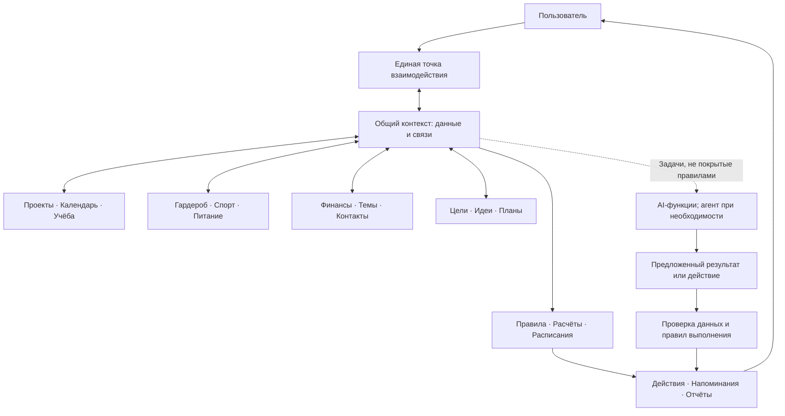

# Личный ассистент · карта возможностей

> **Статус:** материал для обсуждения. Исходные 12 направлений предложены автором проекта. Примеры функций, схема и дополнительные идеи ниже — предложения для согласования, а не утверждённый объём реализации.

## Замысел

**Единая система для личных дел, которая связывает информацию из разных сфер жизни, выполняет понятные автоматизации и привлекает AI для оставшихся задач.**

Пользователь взаимодействует с одним ассистентом. Это само по себе не требует одного универсального LLM-агента или отдельных агентов на каждую сферу.

Ключевой вопрос: какие полезные действия становятся возможны благодаря объединению данных? Формулировку «знает всё обо мне» предстоит перевести в конкретный набор данных, источников и правил обновления.

## Принцип реализации

**Правила и алгоритмы → работающие автоматизации → обоснованное добавление AI → агентная оркестрация при необходимости.**

Для каждой функции сначала ищем обычное программное решение. Извлечение данных моделью или генерация текста сами по себе ещё не означают, что необходим агент с самостоятельным выбором шагов.

| Пример | Обычная автоматизация | Возможная роль AI |
| --- | --- | --- |
| Утренний отчёт | По расписанию выбрать события, дедлайны и показатели; собрать шаблон. | Объяснить связи между событиями, если такая интерпретация нужна пользователю. |
| Поиск помощника среди контактов | Фильтры по навыкам, тегам и прошлым взаимодействиям. | Сопоставить свободное описание проблемы с описаниями опыта людей, когда фильтров недостаточно. |
| Питание по фотографии | Хранение записей и расчёт по подтверждённым продуктам, количеству и справочнику. | Предположить состав блюда; запросить недостающие данные о порции. Оценку не выдаём за точное измерение. |

Каждый AI-сценарий должен иметь объяснение необходимости модели и способ проверки результата. Вызовы AI в таблицах — кандидаты для обсуждения, а не обязательные элементы архитектуры.

## Двенадцать исходных направлений

| Направление | Что можно автоматизировать правилами | Где рассмотреть AI, если правила недостаточны |
| --- | --- | --- |
| **01 · Проекты и задачи** | Статусы, связи задач и проектов, сроки, повторения, уведомления. | Превращение свободного описания проекта в предложенный список задач; разбор неоднозначного запроса. |
| **02 · Календарь и обязательства** | События, повторяющиеся выплаты и сроки документов, поиск пересечений и свободных интервалов. | Извлечение события из сообщения; уточнение неоднозначных дат и условий. |
| **03 · Гардероб и внешность** | Каталог вещей, категории, сезоны, история использования, заранее заданные сочетания. | Описание вещи по фотографии; подбор сочетания под свободно описанную ситуацию. |
| **04 · Спорт** | Расписание, журнал упражнений, подходов и результатов, статистика. | Преобразование свободной записи тренировки в структурированные данные. |
| **05 · Питание** | Дневник, справочник продуктов, расчёт калорий и БЖУ по известным данным. | Предварительное распознавание еды по фото с уточнением состава и количества. |
| **06 · Учёба** | Предметы, занятия, задания, дедлайны, интервальное повторение по алгоритму. | Работа с неструктурированными учебными материалами и вопросами к ним. |
| **07 · Финансы и инвестиции** | Доходы, расходы, бюджеты, регулярные платежи, учёт активов и расчёты по заданным формулам. | Извлечение данных из свободного описания операции или документа. Конкретный инвестиционный сценарий ещё не определён. |
| **08 · Темы и треды** | Подписки на выбранные источники, сбор доступных обновлений, точные дубликаты, фильтры. | Тематическая релевантность, смысловая группировка и краткие обзоры. Нужно уточнить: треды, тренды или оба варианта. |
| **09 · Утренние отчёты** | Сбор данных по расписанию и шаблон: день, сроки, обязательства, выбранные показатели. | Объяснение ситуации с учётом нескольких сфер, если шаблона недостаточно. |
| **10 · Планирование будущего** | Цели, этапы, даты, доступное время, прогресс; планирование по заданным ограничениям. | Проработка расплывчатой цели и вариантов её достижения с уточнением предпочтений. |
| **11 · Идеи и возможности** | Сохранение идей, статусы, теги, связи с проектами и датами пересмотра. | Развитие сырой идеи и поиск смысловых связей с другими заметками. |
| **12 · Контакты** | Карточки людей, навыки, история взаимодействий, поиск по полям и напоминания. | Поиск подходящих людей по смыслу проблемы с объяснением по сохранённым сведениям. |

## Связи между сферами

Проверяем гипотезу: объединение данных должно давать пользу поверх отдельных трекеров.

- **Учёба + проекты + календарь:** показать все ближайшие сроки и пересечения обязательств в одной сводке.
- **Идеи + контакты + проекты:** связать идею с людьми, которые могут помочь, и предложить первые задачи.
- **Гардероб + календарь:** подготовить варианты одежды для сохранённого события с учётом известных требований.
- **Цели + финансы + календарь:** показать требуемые суммы и даты накопления по заданным пользователем условиям.

Это иллюстрации для выбора сценария, не согласованные функции.

## Концептуальная схема

Схема показывает продуктовые связи. Она не определяет стек, сервисы, физическое хранение данных или число агентов.

## Дополнительные идеи для обсуждения

Ни одна идея ниже пока не включена в состав проекта.

| Идея | Пример пользы | Что уточнить |
| --- | --- | --- |
| **Единый входящий поток** | Быстро сохранить сообщение, голосовую заметку, фото или ссылку, затем превратить в задачу, идею, контакт или событие. | Какие форматы действительно нужны? AI требуется только для части преобразований. |
| **Личная база знаний** | Найти сохранённый материал и понять, с каким проектом или предметом он связан. | Где хранятся материалы и нужен ли поиск по смыслу? |
| **Документы и сроки действия** | Помнить об окончании страховки, гарантии, договора или другого документа. | Достаточно карточки и даты или нужно извлечение полей из документа? |
| **Обещания и ожидания** | Отслеживать «я обещал отправить» и «мне должны ответить», связывая записи с контактами и задачами. | Чем такой сценарий должен отличаться от обычной задачи? |
| **Недельный обзор** | По расписанию собрать завершённые дела, переносы и прогресс по целям. | Нужен ли текстовый разбор AI или достаточно показателей и шаблона? |
| **Быт и обслуживание вещей** | Покупки, расходники, уход за одеждой, обслуживание техники. | Какие повторяющиеся дела пользователь действительно хочет отслеживать? |

## Как описываем выбранную функцию

Каждую выбранную функцию оформляем отдельным сценарием:

1. **Пользовательская потребность:** что человек хочет получить и в какой ситуации.
2. **Входные данные и источники:** что уже известно, что вводится вручную, что импортируется.
3. **Триггер:** запрос, время или событие.
4. **Детерминированная часть:** конкретные правила и алгоритмы.
5. **Оставшаяся задача для AI:** необходимость модели и ожидаемый результат, либо «AI не нужен».
6. **Результат:** что видит пользователь и какие данные изменяются.
7. **Проверка:** конкретный пример, ошибки, критерии готовности и участие человека.

До ответов на вопросы не выбираем интерфейс, интеграции и состав MVP. Ближайший раунд вопросов — в [плане обсуждения](discovery.md).
