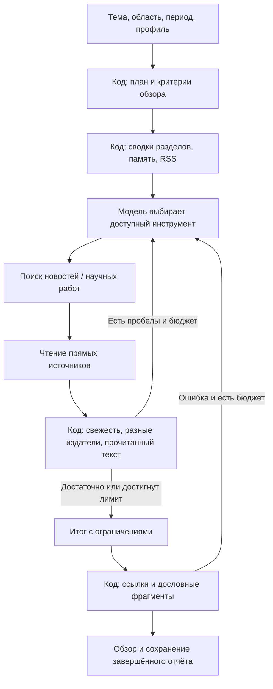

# Как устроен исследователь трендов и какие практики применены

Исследование и реализация: 18 октября 2026. Это развитие [общего поиска трендов](trends.md), предназначенное для учебного проекта с принципом «детерминированный код, затем обоснованный AI».

## Что изучено

| Первичный источник | Применение в нашем проекте |
| --- | --- |
| [Anthropic: Building effective agents](https://www.anthropic.com/engineering/building-effective-agents) | Один ограниченный цикл с обратной связью от инструментов; подготовка и проверка выполняются кодом. Условие завершения и бюджеты явные. |
| [Anthropic: Writing effective tools](https://www.anthropic.com/engineering/writing-tools-for-agents) | Различимые назначения инструментов, примеры аргументов, доступность в зависимости от состояния, компактные структурированные ответы и измерение ошибок. |
| [Anthropic: Context engineering](https://www.anthropic.com/engineering/effective-context-engineering-for-ai-agents) | В модель передаются релевантные сводки и ограниченные фрагменты. Полные отчёты остаются в SQLite; JSON не обрезается посередине записи. |
| [Anthropic: Demystifying evals](https://www.anthropic.com/engineering/demystifying-evals-for-ai-agents) | Проверяем результат и ограничения на сценариях с известным ожидаемым исходом. Отделяем тесты проверяющего кода от оценки поведения реальной модели. |
| [OpenRouter: Tool calling](https://openrouter.ai/docs/guides/features/tool-calling) | Сохраняем идентификаторы вызовов и соответствующие ответы инструментов; оставляем бюджет для завершения. Учитываем сообщённую провайдером модель, токены и стоимость. |

Это выбранные нами инженерные решения на основе рекомендаций, а не подтверждение качества конкретной модели или требование использовать отдельный фреймворк.

## Рабочий процесс



Без включённой модели тот же прикладной слой выполняет фиксированный сценарий. Отдельный LLM-судья не вызывается: проверяемые критерии можно реализовать обычным кодом. Модель нужна для выбора дальнейшего поиска, интерпретации материала и объяснения личной релевантности.

## План и критерии

План содержит тему, разрешённые интересы, границы периода и четыре этапа. Начальные критерии обзора: два разных материала, два издателя, одна страница, прочитанная в текущем запуске, и хотя бы одна публикация с датой в выбранном окне.

`assess_evidence` возвращает текущие показатели, недостающие основания и `nextReadIds`. Критерии относятся ко всему обзору. Они не доказывают каждое отдельное утверждение и не подтверждают глобальный тренд. Неизвестная принадлежность разных сайтов одному медиахолдингу может влиять на оценку независимости; для известных RSS используется каталог издателей.

Материалы с одинаковыми ссылками или нормализованными заголовками не повышают число независимых материалов. Источник из памяти помечается; сохранённый текст не считается новым чтением. Новостная выдача и метаданные Crossref не выдаются за доступный полный текст.

Поиск новостей получает ограничение по началу периода; Crossref фильтруется по периоду и сортируется по дате. Фильтр поиска — пожелание источнику, а не доказательство свежести. Для оценки свежести используется известная дата публикации; дата обнаружения не заменяет её. Старые и недатированные материалы могут оставаться в обзоре с ограничениями.

## Основания отдельной находки

К каждой находке код добавляет `support`: тип основания (`page`, `excerpt`, `metadata`, `mixed`), число издателей, свежие источники, проверенные текстовые фрагменты и ограничения.

`supportingQuotes` необязательны. Если модель приводит фрагмент, он должен дословно встречаться в прочитанной странице или RSS-фрагменте и ссылаться на источник этой находки. Выдуманная цитата отклоняется, модель получает ошибку и может исправить ответ. Совпадение текста не проверяет смысловое следование вывода из цитаты; это остаётся ограничением реализации.

Невыполнение критериев не запрещает полезный частичный обзор: пользователь видит, что именно не подтверждено. Подсчёт роста по двум окнам остаётся отдельной детерминированной процедурой.

## Бюджет, повторы и контекст

- До 8 обращений к модели, 12 действий инструментов, 3 поисков и 4 чтений страниц; агентный цикл до 105 секунд, весь запрос до 118 секунд.
- При использовании `openrouter/free` первая возвращённая модель с суффиксом `:free` закрепляется до конца этого запуска; другой запуск получает отдельный экземпляр планировщика. Платная модель автоматически не выбирается. Если провайдер не сообщает бесплатный идентификатор, запросы продолжают идти через бесплатный маршрут.
- Последние действия резервируются для ответа; отсутствие новых оснований также переводит цикл к завершению.
- Повтор запроса с теми же аргументами использует результат или ошибку текущего запуска. Сетевой вызов не повторяется; действие по-прежнему расходует бюджет цикла.
- Недоступные чтения исключаются из подсказок следующего шага. Инструменты, для которых нет данных или бюджета, убираются из предложения модели.
- Ответы инструментов сокращаются структурно. Старый отчёт из памяти не становится новым внешним доказательством.
- Приватные цели и сводки не превращаются в поисковые запросы; допустимы только тема пользователя и явно разрешённые интересы.

Метрики: обращения к модели, действия, поиски, чтения, попадания в кэш, ошибки, длительность, сообщённые токены, модель и стоимость. Неизвестная стоимость отображается как неизвестная. Длительность метрик агента начинается после сбора RSS; это не полное время запроса.

## Приложение и отмена

Сайт использует `POST /api/trends/research/stream` с NDJSON-событиями `progress`, `result`, `error`. Показываются план, текущая стадия и проверка оснований. Кнопка остановки отменяет fetch; закрытие потока прерывает запросы RSS, поиска и модели через `AbortSignal`. Отменённый незавершённый отчёт не сохраняется. Внешний провайдер мог уже начать обработку; отмена локального запроса не гарантирует отсутствие начислений за уже выполненную часть.

Старый `POST /api/trends/research` продолжает возвращать JSON для других модулей. Другой агент также может вызвать `search_trends` напрямую и получить тот же отчёт.

## Как проверять

```sh
cd backend
npm test
npm run eval:trends
npm run eval:trends -- --live
```

Обычный eval не использует сеть и модель: семь сценариев проверяют оценщик оснований. Тесты также проверяют цитаты, кэш повторов, ограничение контекста, поток событий, отмену и отсутствие записи при отмене.

`--live` отдельно запускает фиксированный сценарий и агента с OpenRouter на публичной теме «AI agents» за 30 дней. Используется синтетический профиль в памяти; локальные пользовательские записи не читаются. Ключ берётся из локального `.env`; выбор модели: `TREND_OPENROUTER_MODEL`, затем `OPENROUTER_MODEL`, затем `openrouter/free`. Отдельная настройка трендов не меняет модель других модулей. Результат содержит показатели, без автоматического объявления победителя.

Один живой пример не измеряет общую точность. Следующий шаг — независимый набор тем из четырёх областей с разметкой полезности, корректности выводов и качества источников, повторные прогоны и сравнение качества/времени/стоимости. Финансовые и медицинские решения не принимаются этим исследователем автоматически.

## Наблюдения живой проверки

На одном публичном запросе `AI agents`, 30 дней, бесплатный случайный маршрут переключал модель между шагами и вернул ограниченный результат. После этого добавлено закрепление бесплатной модели внутри запуска. Отдельный прогон `nvidia/nemotron-3-super-120b-a12b:free` завершился: 14 материалов, один прочитанный источник, 8 вызовов модели, примерно 66 секунд, сообщённая стоимость $0. Подтверждённых дат в выбранном окне не было; обзор остался с ограничениями. Это единичное наблюдение доступности и работы цикла, не оценка общей точности модели.

Для локальной демонстрации эта модель выбрана через `TREND_OPENROUTER_MODEL`. Список бесплатных моделей и поддержка tools проверены по [официальному каталогу API](https://openrouter.ai/api/v1/models). Доступность и лимиты могут меняться; при недоступности остаётся обычный сценарий, платной подмены нет.
