# Общий поиск трендов · первая рабочая версия

## Согласованные требования

- Искать растущие темы и показывать обзор свежих материалов.
- Начать с выбранных открытых RSS-источников и сайтов.
- Обязательный платный API не нужен.
- Использовать службу из разных предметных модулей и будущих агентов.
- Сохранять принцип проекта: максимум детерминированной автоматизации, затем обоснованный AI.

Конкретные первые темы и режим автоматического обновления ещё уточняются. Список стартовых источников и словарь тем — начальная реализация, которую можно менять.

## Где находится реализация

| Путь | Назначение |
| --- | --- |
| `backend/src/trends/service.ts` | Общий сценарий исследования |
| `backend/src/trends/catalog.ts` | Источники, издатели, темы и ключевые слова |
| `backend/src/trends/collector.ts` | Загрузка, разбор RSS и кэш |
| `backend/src/trends/ranking.ts` | Очистка, поиск, группировка и сравнение периодов |
| `backend/src/trends/analyzer.ts` | Интерфейс AI-разбора и адаптер Ollama |
| `backend/src/trends/tool.ts` | Инструмент `search_trends` для других агентов |
| `backend/src/app.ts` | HTTP API |
| `shared/trends.ts` | Общие типы запросов и ответов |
| `frontend/src/modules/trends/` | Экран исследования в Graphite-дизайне |
| `backend/src/tests/trends.test.ts` | Автоматические проверки |

## Процесс

```mermaid
flowchart LR
    Q[Запрос: область, тема, период] --> S[Выбор разрешённых источников]
    S --> F[Загрузка RSS или явный демонабор]
    F --> V[Даты, ссылки, очистка и дубликаты]
    V --> G[Группировка по словарю тем]
    G --> R[Сравнение двух равных периодов]
    R --> O[Темы, публикации и источники]
    O -. По запросу; модель настроена .-> AI[AI-разбор по найденным материалам]
    AI --> C[JSON-схема и проверка ссылок]
    C --> OUT[Общий результат API]
    O --> OUT
```

Это фиксированный рабочий процесс с необязательным вызовом модели, а не автономный агент, который сам выбирает произвольные инструменты. Его можно зарегистрировать как инструмент оркестратора. Такой старт соответствует требованию преподавателя; автономность добавим при появлении сценария, который требует динамического планирования.

## Что выполняет обычный код

1. Проверяет область, период, длину запроса и лимит результатов.
2. Выбирает RSS из серверного каталога; ограничивает время и размер ответа.
3. Разбирает публикации, приводит даты и ссылки к общему формату.
4. Убирает трекеры, повторы ссылок и заголовков, будущие и некорректные даты.
5. Ищет по запросу и известным двуязычным синонимам, группирует по словарю.
6. Сравнивает число публикаций за два соседних периода одинаковой длины.
7. Возвращает метрики, публикации и состояния источников.

### Критерий сигнала роста

«Рост в выборке» показывается, когда одновременно есть:

- минимум 3 текущих публикации;
- минимум 2 публикации в предыдущем периоде;
- минимум 2 разных издателя в текущем периоде;
- рост количества упоминаний минимум на 50%.

Расчёт: `(текущее / предыдущее - 1) × 100%`. При отсутствии предыдущих публикаций процент не рассчитывается; показываем «нет предыдущих упоминаний». Несколько RSS-лент одного издателя не увеличивают число независимых издателей. Неопознанные материалы объединяются для просмотра и не получают сигнал роста.

Эти пороги — стартовая эвристика, не подтверждённая оценка качества. Ленты могут не покрывать оба периода полностью. Для надёжного анализа динамики следующим этапом нужны ежедневные снимки, история покрытия и проверка на размеченных примерах.

## Стартовые живые источники

| Область | Источник | Лента |
| --- | --- | --- |
| Финансы | European Central Bank | `https://www.ecb.europa.eu/rss/press.html` |
| Спорт | ScienceDaily · Fitness | `https://www.sciencedaily.com/rss/health_medicine/fitness.xml` |
| Питание | ScienceDaily · Nutrition | `https://www.sciencedaily.com/rss/health_medicine/nutrition.xml` |
| Гардероб | Vogue | `https://www.vogue.com/feed/rss` |

Это ограниченная стартовая выборка. Издателей всего три: ScienceDaily объединяет две ленты. Для дел и календаря живые источники пока не выбраны. Ошибки отдельных источников видны; при недоступности всех источников получаем ошибку, без подмены демоданными.

## Где используется AI

Необязательный AI-разбор объясняет найденные материалы на русском и связывает объяснение с идентификаторами публикаций. Модель не пересчитывает рост и не назначает источникам новые даты. Ответ проходит структурную проверку и проверку принадлежности ссылок; это не доказывает фактическую правильность каждой фразы, поэтому первоисточники остаются доступными.

По умолчанию AI выключен. Подготовлен локальный адаптер Ollama с JSON Schema по [официальной документации structured outputs](https://docs.ollama.com/capabilities/structured-outputs) и [chat API](https://docs.ollama.com/api/chat). Модель не устанавливается автоматически. Адаптер проверен на контролируемом ответе в тестах; реальный прогон требует установленной модели. Другой провайдер подключается через `TrendAnalyzer`.

## Проверка и демонстрация

Демонабор искусственный, с фиксированной опорной датой `2026-10-17T12:00:00Z`. Он нужен для одинаковых проверок у всех участников; ссылки ведут на `example.com/demo/...` и не выдаются за реальные публикации. При изменении периода ожидаемое распределение упоминаний также меняется.

Автотесты проверяют нормализацию, дубликаты, даты, двуязычный запрос, издателей, нулевую базу, кэш, ошибки и ограничения источников, ответы AI и API. Для проверки реальных сетей используем отдельный ручной запрос в live-режиме; сеть не требуется для `npm test`.

## Следующие продуктовые решения

- Выбрать 2–3 конкретные темы и достаточный набор независимых источников.
- Определить расписание: запрос или ежедневное обновление.
- Добавить долговременную историю перед более уверенными выводами о росте.
- Согласовать, какой результат получает каждый предметный агент: обзор, публикации или сигнал для последующего действия.
- При необходимости добавить источники со страниц сайтов, затем поисковый API как отдельный адаптер.
- Подключить конкретную локальную модель и проверить качество объяснений на размеченных примерах.
