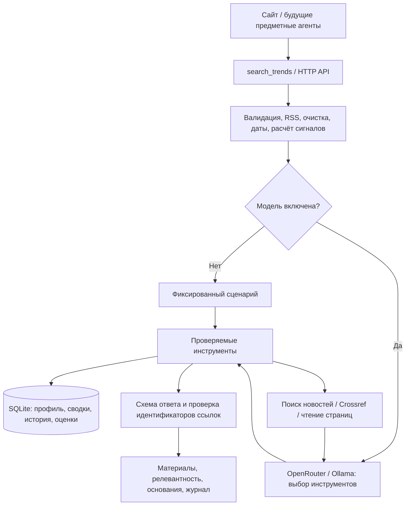

# Персональный исследователь трендов

Общая служба для четырёх разделов приложения: дела, финансы, спорт и питание, гардероб. Находит материалы, сравнивает упоминания и объясняет личную релевантность. Доступна через сайт, HTTP API и инструмент `search_trends` для будущего оркестратора.

## Принцип: автоматизация, затем агент

Сбор RSS, очистка, даты, сравнение периодов, память, ограничения и проверка ссылок выполняются обычным кодом. Без модели работает фиксированный сценарий инструментов. Перед планированием обычный код читает профиль, сводки разделов, релевантную память и RSS. При `strategy=agent` и `enableAi=true` модель выбирает дополнительные действия по результатам предыдущих: уточнить обзор, найти научные основания, прочитать страницу, запросить память ещё раз, завершить исследование.

Динамический выбор нужен, поскольку после поиска заранее неизвестны доступность текста, достаточность оснований и необходимость дополнительной проверки. Модель не управляет формулами роста, не получает доступ к файловой системе и не изменяет данные других разделов.

## Инструменты

| Инструмент | Назначение |
| --- | --- |
| `get_user_context` | Интересы, цели, ограничения, опыт и разрешённые темы поиска |
| `get_module_context` | Сводки разделов выбранной области с датой обновления |
| `search_memory` | Релевантные исследования этого профиля, области и режима |
| `get_feed_evidence` | Датированные RSS-публикации и рассчитанные сигналы |
| `search_web` | Поиск новостей; при настроенном SearXNG — поиск по вебу |
| `search_papers` | Научные метаданные Crossref, DOI и ссылки на публикации |
| `read_page` | Доступный текст по идентификатору уже найденного материала |
| `finish_research` | Итог, объяснение релевантности и проверяемые ссылки |

Бюджет одного запуска: до 8 обращений к модели, 12 вызовов инструментов, 3 поисков и 4 чтений страниц; до 105 секунд агентного цикла. До трёх исследований одновременно. Ошибки инструментов видны в журнале. Если модель недоступна, возвращаем доступные результаты обычного сценария с явным статусом ограничения.

## Память и персонализация

По умолчанию сервер хранит `backend/data/trends.sqlite` (путь считается из рабочей директории backend). База, SQLite-журналы и `.env` исключены из Git.

- Профиль: редактируемые интересы, цели, контекст, исключённые темы, опыт.
- Контекст разделов: ограниченные текстовые сводки, дата синхронизации, источник.
- История: отчёты, запросы, материалы и результаты инструментов.
- Архив: датированные живые публикации; у повторно встреченной ссылки сохраняется первая записанная дата публикации.
- Обратная связь: «Полезно» повышает оценку, «Не по теме» исключает ссылку из следующих результатов. Это правила ранжирования, а не обучение весов модели.

Локальная оценка учитывает совпадения интересов, целей и контекста, прежние оценки и повторы. Пользователь видит причины. Демо и live разделены; разные `profileId` не смешиваются. `remember=false` отключает запись отчёта и наблюдений этого запуска, но разрешает чтение уже сохранённой памяти. Обновление профиля/сводок и оценки — отдельные действия.

`DELETE` истории удаляет выбранный отчёт; архив публикаций, отметки встречавшихся ссылок и оценки остаются. Автоматической очистки по сроку пока нет.

### Данные модулей

Перед исследованием сайт может синхронизировать сводки через `PUT /api/trends/profiles/:id/modules`. Флажок «Учитывать данные разделов» выключает синхронизацию и использование этих сводок для конкретного исследования.

Готов адаптер существующего браузерного каталога гардероба `graphite-wardrobe`: количество вещей, категории, цвета, сезоны, число образов и записей носки. Доступ только на чтение. Фото, названия вещей, бренды и свободные заметки не передаются. При отсутствии каталога сохраняется пустая сводка, а не утверждение об отсутствии вещей.

Для дел, финансов и здоровья хранилища ещё не реализованы. Их команды могут зарегистрировать `ModuleContextAdapter` через `registerModuleContextAdapter` в `frontend/src/modules/trends/moduleContext.ts` либо передавать сводку с backend. Пустые модули не подменяются вымышленными балансами или тренировками. В API-клиенте другого агента синхронизация контекста выполняется отдельно от `search_trends`.

### Что уходит во внешние сервисы

Поисковик получает только явно заданную тему запроса и, если пользователь разрешил, интересы профиля. Цели, сводки и ограничения не превращаются в поисковые запросы. Инструмент принимает `topicId` из разрешённого списка, а не произвольный текст модели.

При включённой модели профиль, сводки выбранных разделов, найденные материалы и извлечённая история передаются провайдеру модели: OpenRouter либо настроенной Ollama. Поэтому данные не обязательно остаются на устройстве, если используется OpenRouter. Ключ API хранится только на backend и не включается в ответы или журнал.

## Интернет без обязательной оплаты

По умолчанию `search_web` использует открытый Google News RSS. Это поиск по новостям, а не индекс всего веба. Ссылки агрегатора показываются как поисковая выдача; их оболочка не считается прочитанным первоисточником. Для более широкого поиска можно задать `TREND_SEARXNG_URL` — свой экземпляр SearXNG с включённым JSON-форматом.

`search_papers` использует открытый Crossref. Метаданные, DOI и аннотация не означают доступ к полному тексту. Бесплатные сервисы могут ограничивать запросы, страницы — закрываться от автоматического чтения; ошибки возвращаются явно. Платные поисковые плагины OpenRouter не используются.

Чтение страниц ограничено размером, временем и HTTP(S); JavaScript не исполняется. Проверяются адреса DNS и каждый редирект, запрещены локальные/частные IP, выбранный публичный IP фиксируется для соединения. Страницы и старая память считаются недоверенными данными. Инструкции в них не расширяют возможности инструментов.

## Даты и критерий роста

Только датированные RSS-публикации и прочитанные страницы с установленной датой участвуют в расчёте. Дату поисковой выдачи не считаем датой публикации; при её отсутствии выводим «не установлена». Веб-материалы без даты доступны для обзора. Рост в выборке не означает глобальный рост популярности.

Сигнал «Рост в выборке» требует одновременно:

- минимум 3 публикации в текущем окне;
- минимум 2 в предыдущем окне той же длины;
- минимум 2 независимых издателя сейчас;
- роста упоминаний минимум на 50%: `(текущее / предыдущее - 1) × 100%`.

При нулевой базе процент не рассчитывается. Ленты одного издателя не считаются независимыми. Детерминированная группировка использует двуязычный словарь в `catalog.ts`; незнакомая тема может иметь обзор материалов без отдельного сигнала роста. Пороги — начальная эвристика, качество ещё нужно измерять на размеченном наборе. Сохранённая история постепенно расширяет выборку, но не гарантирует полноту покрытия периодов; ежедневного расписания пока нет.

## Стартовые RSS-источники

| Область | Источник | Лента |
| --- | --- | --- |
| Финансы | European Central Bank | `https://www.ecb.europa.eu/rss/press.html` |
| Спорт | ScienceDaily Fitness | `https://www.sciencedaily.com/rss/health_medicine/fitness.xml` |
| Питание | ScienceDaily Nutrition | `https://www.sciencedaily.com/rss/health_medicine/nutrition.xml` |
| Гардероб | Vogue | `https://www.vogue.com/feed/rss` |

Для дел пока нет каталожной RSS-ленты; при включённом веб-поиске исследование возможно по теме. Ошибка сети не приводит к скрытой подмене демоданными.

## Провайдер модели

Выбран OpenRouter. `OPENROUTER_API_KEY` задаётся только в локальном `backend/.env`; `OPENROUTER_MODEL=openrouter/free` — бесплатный маршрут с поддержкой требуемых возможностей. Автоматического перехода на платную модель нет. [Документация бесплатного маршрута](https://openrouter.ai/docs/guides/routing/routers/free-router), [протокол вызова инструментов](https://openrouter.ai/docs/guides/features/tool-calling).

Бесплатные лимиты и конкретная модель маршрута могут меняться. Для воспроизводимой проверки качества позже следует закрепить выбранную модель и измерять точность, время и стоимость. Другой провайдер реализует `ResearchPlanner`; локальная Ollama остаётся альтернативой через `TREND_LLM_MODEL` и `TREND_LLM_URL`. При наличии ключа OpenRouter имеет приоритет. Без обеих настроек сценарий инструментов работает без LLM.

Проверка схемы и существования ссылок не доказывает достоверность каждого вывода модели. В интерфейсе доступны первоисточники и журнал действий.

## Реализация и проверки

| Путь | Назначение |
| --- | --- |
| `backend/src/trends/service.ts` | Общая служба и сравнение периодов |
| `agent.ts`, `planner.ts` | Бюджеты, инструменты, цикл выбора, OpenRouter/Ollama |
| `memory.ts`, `personalization.ts` | SQLite и объяснимое ранжирование |
| `web.ts` | Поиск новостей, научные работы, безопасное чтение |
| `routes.ts`, `tool.ts` | HTTP API и подключение других агентов |
| `shared/trends.ts` | Контракты |
| `frontend/src/modules/trends/` | Экран профиля, памяти и исследования |
| `backend/src/tests/research-agent.test.ts` | Контекст, память, инструменты, сеть, ограничения |

`npm test` в backend выполняется без реальной сети и модели. Сборки backend/frontend и frontend lint проверяют интеграцию. Отдельные живые прогоны проверяют доступность поиска, Crossref и OpenRouter; доступность внешних сервисов может меняться.

Демо использует искусственный набор с фиксированной датой `2026-10-17T12:00:00Z`, явно помеченный в UI. При включении LLM итог демо может меняться; для одинакового результата оставьте модель выключенной.

API остаётся локальным прототипом: `profileId` — разделение данных, не авторизация. До публикации сервера нужны пользователи, проверка доступа и политика хранения. Следующие продуктовые шаги: выбрать контрольные темы, собрать размеченный набор, подключить данные остальных разделов и определить расписание.
