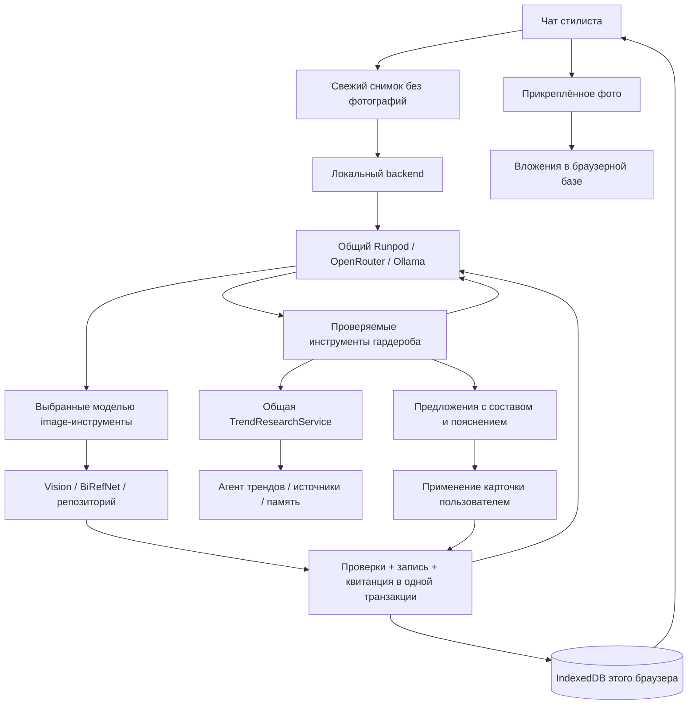

# Стилист внутри гардероба

## Возможности

Во вкладке **«Гардероб → Стилист»** работает разговорный агент с инструментами. Он читает актуальную коллекцию и историю носки, предлагает образы из существующих вещей, готовит покупки, помогает заполнить карточку новой вещи или изменить характеристики, обращается к общей службе трендов.

Сообщения и результаты применения карточек сохраняются в этом браузере: ключ `${repository.namespace}:stylist-chat-v1`, последние 40 сообщений. При новом запросе передаются последние 20 сообщений и свежий снимок каталога. История демостенда отделена от личной коллекции. «Новый диалог» очищает сообщения, сохраняя вещи и образы.

Изображения, добавление вещи, изменение описания и замена фото выполняются инструментами по решению модели прямо в чате. Пользователь пишет намерение; отдельного переключателя автодобавления нет. Инструмент добавления сам распознаёт фото и заполняет поля. Квитанция появляется только после записи. Подробности, схемы и проверки: [инструменты фото и гардероба](wardrobe-chat-photos.md).

Карточки образов, покупок и отметок носки доступны для последующего применения через общий репозиторий. Ответ модели сам по себе не изменяет данные. Повторное применение одного действия не создаёт повторную запись.

## Архитектура



Один предметный агент использует существующий `ResearchPlanner`; нового оркестратора и отдельной службы модных новостей нет. Вызов трендов проходит через тот же `TrendResearchService.search`, что HTTP API и опубликованный инструмент `search_trends`. Отмена чата передаётся в исследование.

### Инструменты

| Инструмент | Результат |
| --- | --- |
| `wardrobe_search` | Поиск вещей по запросу, категории, цвету, сезону, отсутствию носки; реальные ID и счётчики |
| `wardrobe_outfits` | Сохранённые образы, состав, отсутствующие вещи, дни в сочетании |
| `wardrobe_statistics` | Период 7/30 дней или вся доступная история; дни носки без удвоений |
| `wardrobe_wishlist` | Желания и купленные вещи, суммы отдельно по валютам |
| `wardrobe_prepare_outfit` | Карточка образа из 1–20 уникальных ID существующих вещей |
| `wardrobe_prepare_purchase` | Карточка желания; цена целым числом в копейках/центах, неизвестная цена = null |
| `wardrobe_prepare_garment` | Поля для обычной формы добавления вещи с загрузкой фото |
| `wardrobe_prepare_update` | Изменение указанных полей с сохранением фото и проверкой версии записи |
| `wardrobe_prepare_wear` | Отметка носки существующего образа на существующую дату не позже сегодняшней |
| `wardrobe_search_trends` | Исследование моды: источники, даты, выдержки, результаты и ограничения качества |
| `wardrobe_finish` | Ответ с проверкой ID цитируемых источников |

Дополнительно доступны `wardrobe_inspect_image`, `wardrobe_remove_background`, `wardrobe_add_from_image`, `wardrobe_update_garment`, `wardrobe_replace_photo`. В чате они заменяют prepare_garment/prepare_update: изменение выполняется сразу по запросу. Инструменты удаления, оплаты и исполнения кода не доступны.

## Применённые практики

1. **Простой управляемый цикл.** Модель выбирает инструменты, получает фактические результаты, затем отвечает. Счётчики, даты, деньги, расположение вещей и сохранение выполняются детерминированным кодом. Это применение рекомендаций [Anthropic о простых композиционных агентах](https://www.anthropic.com/engineering/building-effective-agents).
2. **Узкие инструменты.** Имена имеют префикс `wardrobe_`, назначения различаются; в описаниях указаны единицы цены, реальные ID, ограничения и отличие предложения от сохранения. Чтение возвращает ограниченную выборку, а не весь каталог в контекст модели. Основание — [Writing effective tools for AI agents](https://www.anthropic.com/engineering/writing-tools-for-agents).
3. **Проверки в коде.** Аргументы проверяются Zod; неизвестные поля/инструменты, отсутствующие ID, повторы вещей, опасные ссылки, ошибочные суммы и даты возвращаются модели как ошибки. Следующий вызов может исправить ошибку. Перед применением повторно используются проверки общего репозитория.
4. **Ограниченный бюджет.** До 8 обращений к модели, 12 инструментов, 6 карточек, одного исследования трендов и 15 минут для чата с браузерными инструментами; JSON API ограничен 300 секундами для Runpod и 150 для остальных провайдеров. Распознавание отдельного фото ограничено 90 секундами. Не более двух одновременных запросов стилиста. Бюджет вложенного исследования дополнительно ограничен самой службой трендов. Отмена закрывает запросы модели и исследования.
5. **Данные отделены от полномочий.** Названия, заметки, прошлые сообщения и материалы интернета считаются данными. Модель не получает файловую систему, SQL или произвольный HTTP-клиент. Модель выбирает короткую публичную тему из запроса о моде и аспект исследования; инструкции запрещают переносить личные сведения в поисковый запрос. Это не доказательство полной устойчивости модели к prompt injection: ограничения инструментов и применение карточек обеспечиваются кодом.
6. **Проверяемый результат.** Источники сопоставляются по ID, показываются даты и различие между прочитанной страницей и выдержкой. Отчёт качества общей службы передаётся стилисту; неполные основания не должны превращаться в уверенное утверждение о мировом тренде. Проверка ID не доказывает истинность каждого предложения модели.
7. **Наблюдаемость.** NDJSON передаёт текущие этапы до окончательного ответа. В сообщении сохраняются имена инструментов, успехи/ошибки и длительность; внутренние рассуждения модели не показываются. Метрики учитывают обращения к модели, длительность, переданные провайдером токены, модели и стоимость; неизвестная стоимость остаётся null. Стоимость вложенного исследования учитывается его собственной службой. Свободный маршрут OpenRouter закрепляет выбранную бесплатную модель в пределах запуска, когда провайдер возвращает её ID. Последний шаг резервируется под завершение. Недоступность модели, отмена, незавершённый поток и превышение бюджета обозначаются явно.
8. **Проверка по результату.** Автоматические сценарии проверяют реальное состояние IndexedDB и ошибки, а отдельный opt-in live-eval — применение инструментов настоящей моделью. Основание — [Demystifying evals for AI agents](https://www.anthropic.com/engineering/demystifying-evals-for-ai-agents). Два живых сценария — начальная проверка интеграции, не оценка общего качества стилиста.

Протокол инструментов соответствует [OpenRouter Tool Calling](https://openrouter.ai/docs/guides/features/tool-calling). Ключ провайдера хранится только в backend.

## Данные и хранение

Снимок для backend содержит введённые названия, категории, цвета, сезоны, бренды, заметки, ID, состав образов, желания и историю носки. Фотографии, Blob и object URL исключены явной проекцией. Только явно прикреплённые в чате фото уходят уменьшенной копией через отдельный vision API; оригинал остаётся в браузерном гардеробе. [Контракт и проверки фото](wardrobe-chat-photos.md). Модель получает только результаты вызванных инструментов; короткие заметки в выдаче ограничены 200 символами. Полный текст существующей заметки сохраняется при изменении других полей.

Максимум снимка: 500 вещей, 250 образов, 2000 событий носки, 250 желаний. Общие количества передаются отдельно; ограниченная выборка явно обозначается в результатах и интерфейсе. Поиск пока работает по переданному снимку. Для очень большой коллекции следующим шагом будет постраничный доступ к браузерному каталогу через отдельный клиентский инструмент.

В поиск трендов отправляются выбранная моделью публичная тема запроса и фиксированный аспект. Обычный чат не требует заполнять настройки поиска. Общая память трендов обновляется агрегатами категорий и количеством вещей/образов. Названия, фото, бренды, свободные заметки и записи носки не записываются в эту сводку. В инструментах поиска модель получает указание исключать личные данные; отдельной семантической проверки сформулированной темы пока нет. Исследование хранится в общем профиле `default` и видно в истории раздела трендов. Сводка отражает состояние на момент обращения.

IndexedDB обновлён до **версии 4**: добавлен `agentActions` с ID применённой карточки, видом и временем. Изменение данных и квитанция сохраняются атомарно. Квитанции остаются при очистке чата, чтобы старая карточка не повторила действие. Если результат позже удалён вручную, повтор старой карточки его не восстанавливает. Изменение вещи/отметка образа дополнительно проверяют `updatedAt` внутри той же транзакции.

Markdown отображается через `react-markdown`, без HTML и внешних изображений. Активные ссылки ответа ограничены источниками, полученными от службы трендов. Чат загружается отдельным JS/CSS chunk.

Это локальный прототип. Сервер привязан к loopback, `profileId=default` не является авторизацией. Публикация и серверное хранение гардероба требуют отдельного пользовательского доступа.

## Запуск и проверка

Backend использует общий провайдер платформы. Настроенный `RUNPOD_LLM_ENDPOINT_ID` имеет приоритет и применяется к исследователю и стилисту. Иначе используются `OPENROUTER_API_KEY` и `OPENROUTER_MODEL`; маршрут по умолчанию — `openrouter/free`, без автоматического платного fallback. Модель OpenRouter для стилиста можно переопределить через `WARDROBE_OPENROUTER_MODEL`. Без этих провайдеров доступны `WARDROBE_LLM_MODEL`/`WARDROBE_LLM_URL`, затем общие `TREND_LLM_MODEL`/`TREND_LLM_URL`.

```sh
cd backend
npm run dev
npm test
npm run eval:wardrobe
```

`eval:wardrobe` выполняет реальные запросы к настроенному провайдеру на искусственном гардеробе без фотографий и не сохраняет вещи/образы. При настроенном LLM endpoint Runpod этот запуск использует его; обработку фотографий BiRefNet не вызывает. Он не входит в обычный `npm test`. Зафиксированный ниже живой прогон выполнен через OpenRouter.

API:

- `GET /api/wardrobe/agent/capabilities`
- `POST /api/wardrobe/agent/photos/inspect` — распознавание прикреплённого изображения
- `POST /api/wardrobe/agent/tool-results/:token` — одноразовый результат браузерного инструмента
- `POST /api/wardrobe/agent/chat` — JSON; браузерные инструменты доступны через поток
- `POST /api/wardrobe/agent/chat/stream` — NDJSON с этапами и конечным результатом

Проверено 18 октября 2026 года:

- Сборки backend/frontend, frontend lint и строгая проверка TS браузерного стенда проходят.
- Проверки агента и платформы: строгие схемы, восстановление после ошибок инструментов, ограничения, отмена, связь с реальной службой трендов при подменённой сети, ID источников, атомарность, повторы, устаревшие изменения, сохранность фотографий, декодирование потока. В составе запуска используются fake-indexeddb и 18 регрессионных проверок существующего каталога.
- Live OpenRouter: **2/2**. Образ использует три существующие вещи и не исполняет инструкцию из тестовой заметки; покупка хранит точную сумму 650050 копеек и пустую неизвестную ссылку. Примерное время — 30 и 11 секунд; это единичные измерения.
- Проверена доступность capabilities и потокового маршрута через Vite proxy на `http://localhost:5175`.
- В браузерный стенд добавлен сценарий чата с применением карточки и проверкой состояния каталога. Реальный браузерный прогон нового интерфейса пока не выполнен: нативный Computer Use недоступен (`Sky Computer Use native pipe startup failed`).

Следующая оценка качества: реальные фотографии и характеристики вещей, разные поводы/погода/бюджеты, сравнение моделей на фиксированном наборе задач, доля принятых предложений, корректность применения и обоснованность модных рекомендаций. Распознавание прикреплённых изображений реализовано; виртуальной примерки пока нет. Качество на разнообразных реальных фотографиях ещё не измерено.
