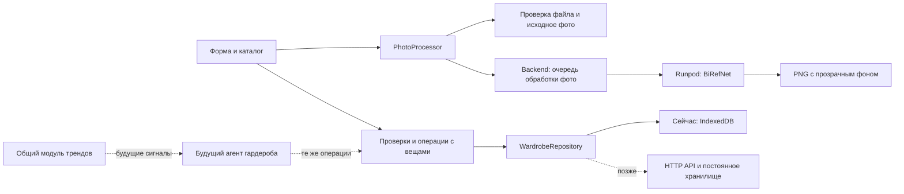

# Гардероб · сценарии и реализация

## Контекст и пожелания автора

Раздел личного ассистента, за который отвечает автор запроса. Основная последовательность: детерминированные инструменты → специализированная обработка фото → агенты поверх этих инструментов.

- Удобная загрузка фотографии вещи и красивый каталог.
- Категории: верх, низ, верхняя одежда, платья/комбинезоны, обувь, сумки, аксессуары; поиск и фильтры.
- Промежуточный CV-обработчик, удаляющий фон: BiRefNet на Runpod Serverless, вызов через backend. Локальный запуск модели не используется.
- Составление сочетаний из нескольких вещей и их визуализация.
- Статистика носки вещей и сочетаний с отметкой «Надел сегодня» — подтверждено автором.
- Список желаемых покупок, аксессуаров и цен.
- Позднее — связь с агентом трендов и предложения по дополнению гардероба.

## Первый реализованный сценарий

Открыть «Гардероб» → «Добавить вещь» → загрузить фото → вручную заполнить характеристики → сохранить → найти вещь в каталоге → открыть и изменить.

Реализовано в `frontend/src/modules/wardrobe/`:

- Загрузка с устройства или перетаскиванием: JPG, PNG, WebP, до 15 МБ и 40 Мп. Проверяется возможность декодирования изображения.
- Название, категория, цвет, сезон, необязательные бренд и заметка. В чате «Стилист» доступно распознавание полей по прикреплённой фотографии и автоматическое добавление.
- Карточки с фотографиями, счётчики вещей, образов и желаемых покупок, поиск по названию, бренду, заметкам, категории и цвету.
- Фильтры по категории, цвету и сезону; сортировка по новизне и названию. Вещи «Круглый год» показываются при выборе конкретного сезона.
- Редактирование, замена фотографии и удаление с подтверждением внутри формы.
- IndexedDB сохраняет метаданные и фотографии как Blob. Успех отображается только после завершения транзакции. По кнопке «Удалить фон» уменьшенная копия отправляется через backend на Runpod; обычное добавление фото не вызывает модель.
- Состояния очереди и обработки, отмена запроса, явный повтор после ошибки и возврат к оригиналу. Обработанный PNG и оригинал сохраняются отдельно.
- Состояния загрузки, ошибки хранилища с повтором, ошибки файла и пустые результаты.
- Адаптивная вёрстка в существующей теме Graphite, нативный модальный диалог с фокусом и Escape.

Для удаления фона реализованы Runpod worker и backend API. Состояние реального развёртывания и GPU-проверки фиксируется отдельно от браузерных проверок с подменой провайдера. Серверное хранилище вещей и фотографии между устройствами пока не добавлены.

**Подтверждено автором:** текущая версия — личный гардероб в одном браузере. Серверная синхронизация сейчас не требуется. Данные привязаны к origin (включая порт), не синхронизируются между устройствами и могут быть удалены при очистке данных сайта. Экспорт, резервное копирование и авторизация пока отсутствуют.

## Границы компонентов

`types.ts` задаёт `Garment`, `GarmentDraft`, `GarmentPhoto`, `PhotoProcessor` и `WardrobeRepository`. Загрузка возвращает оригинал с `processing: 'original'`. Отдельная операция `removePhotoBackground` создаёт задачу на backend; только полученный и декодированный PNG меняет `display` и `processing` на `background-removed`. `original` сохраняет исходный Blob. Подробности: [BiRefNet на Runpod](../services/birefnet/README.md).

Реализованный транспорт обработки: файл → job ID → queued/running/succeeded/failed/cancelled → отдельный PNG. Секрет Runpod остаётся на backend; UI не обращается к Runpod с ключом напрямую. Ошибка оставляет оригинал доступным, повтор запускается явно. Вещи по-прежнему хранятся в IndexedDB; состояние задач — в памяти backend, после его перезапуска обработку нужно повторить. Постоянное хранилище файлов и синхронизация вещей — следующий этап.

Для ручного каталога вызов LLM не нужен. Удаление фона — отдельная операция компьютерного зрения; наличие обученной модели само по себе не делает её агентом. Во вкладке «Стилист» теперь подключён разговорный агент с инструментами чтения, подготовки образов, покупок, карточек вещей и отметок носки. Применение использует общий репозиторий и транзакционные проверки. Архитектура, связь с трендами, практики и проверки описаны в [wardrobe-agent.md](wardrobe-agent.md).

## Порядок следующих этапов

1. **Коллаж — реализован.** Образ хранит ссылки на вещи, координаты, размер и порядок слоёв. Коллаж помогает оценить сочетание; посадка на человеке и виртуальная примерка остаются отдельным сценарием.
2. **Образы и журнал носки — реализованы.** `Outfit` и `WearEvent` хранят композицию и снимок состава на момент выхода. Счётчики и последний выход вычисляются по событиям; правила повторов и удалённых вещей описаны выше.
3. **Желаемые покупки — реализованы.** `WishlistItem`: название, категория, фото, ссылка, сумма, валюта, приоритет, состояние planned/purchased. Суммы считаются отдельно по валютам. Перенос покупки в гардероб — явное действие; цена не означает фактический расход в модуле финансов.
4. **Серверное хранение и оценка обработки фото.** Для удаления фона выбран BiRefNet на Runpod. Дальше выбираем доступ между устройствами и хранилище файлов, оцениваем точность цвета, сохранность деталей и прозрачность на общем наборе фото.
5. **Стилист и тренды — реализованы.** Чат предлагает сочетания на основе каталога, статистики и исследований общей службы трендов. Проверяемые карточки применяются через общий репозиторий; IndexedDB v4 хранит квитанции действий и защищает от повторов. Распознавание полей по прикреплённой фотографии и автоматическое сохранение оригинала реализованы. [Фото в чате](wardrobe-chat-photos.md). [Контракт и практики агента](wardrobe-agent.md).

Этапы 1–3 реализованы. Для этапа 3 выбран ручной ввод цены и ссылки; автоматическое отслеживание цены пока не добавлено. Детали оставшихся этапов и их приоритет ещё обсуждаются.

## Открытые вопросы

- Фото одной вещи без человека — допустимое ограничение первого сценария? Нужны ли фото на человеке и выделение нескольких вещей из одного снимка?
- Для списка покупок хватит ручной цены и ссылки, или требуется отслеживание цены магазина?
- Какие стиль и контекст учитывать дальше: повседневный, работа, спорт; погода, сезон, конкретное событие?

## Приёмка первого сценария

1. Добавить реальный JPG/PNG/WebP, заполнить название и характеристики; увидеть карточку и исходное фото.
2. Перезагрузить страницу на том же адресе; вещь и фото доступны.
3. Проверить поиск, категорию, цвет и сезон, включая круглогодичную вещь; сбросить фильтры.
4. Изменить название и фото; после перезагрузки увидеть изменения.
5. Проверить отказ для неподдерживаемого/повреждённого файла и превышения лимита: вещь не создаётся, ошибка видна, другое фото можно выбрать.
6. Отменить диалог клавишей Escape; пройти поля клавиатурой; проверить экран телефона.
7. Удалить тестовую вещь через форму; после перезагрузки её нет.

### Выполненные проверки

**BiRefNet, 2026-10-18:** production endpoint `qzgs7ssd6bf2df` (`graphite-birefnet-worker`) развёрнут и подключён через `backend/.env`. Задача `00265b61-a2aa-46db-9ea8-3455511976ca-u1`, отправленная через API приложения, завершилась `COMPLETED`: очередь 16,282 с, выполнение 10,052 с. Затем API приложения вернул `succeeded` и PNG 640 × 480, RGBA, 807 189 байт, alpha 0–255. Проверка использует публичный пример Hugging Face с двумя кошками: это подтверждение интеграции, не оценка качества на одежде. Отдельная проверка на фотографиях вещей ещё нужна. Dev endpoints, созданные в этой работе, удалены; production оставлен с workers 0–1. По просьбе минимизировать расходы idle timeout затем уменьшен с 20 до 1 секунды; новые значения проверены чтением endpoint без запуска платных тестовых задач.

`npm run build`, `npm run lint` и отдельная строгая проверка TypeScript для браузерных тестов проходят. При запущенном Vite страница `/tests/wardrobe.html` проверяет реальный IndexedDB и обработчик файлов в отдельной случайной базе, удаляемой после прогона. Проверки обработки фона используют подменённый HTTP-транспорт и не обращаются к Runpod.

Дополнительно проверены миграция с версии 1, сохранение композиции, параллельные повторы, одинаковый состав в разных образах, неизменность истории, отмена отметок, неверные даты и удалённые вещи. React-проверки покрывают управление стрелками, форму редактора и обработчики pointer events; для синтетического pointer-теста подменяется только захват указателя браузером. Результат прогона фиксируется в заголовке и на странице тестов.

`/tests/wardrobe-preview.html` — визуальный стенд с тремя схематичными вещами, отдельной базой `graphite-wardrobe-apple-preview` и настоящим компонентом гардероба. Он позволяет проверять интерфейс без загрузки личных фотографий. Это dev-страница, она не включается в production-сборку.

В предыдущей итерации в завершённом браузерном прогоне: **24 PASS, 0 FAIL**. После него добавлена отдельная проверка обработчиков перетаскивания; полный набор теперь содержит 25 проверок, повторный браузерный прогон пока не завершён из-за закрытия окна Computer Use. Скриншоты карточек и редактора просмотрены. Физический жест перетаскивания и проверка на телефоне пока не завершены.

## Обновление UI/UX · macOS Dark

По запросу автора выбран тёмный интерфейс в стиле macOS. Переоформлен только гардероб: системная SF-типографика, графитовые поверхности, компактный segmented control, карточки с фотографиями, сгруппированные формы, обратная связь через закрываемые уведомления. Токены и стили находятся в `apple.css`; общая оболочка и стили других модулей не переопределяются.

### Каталог

- Выбор нескольких вещей (до 20) и переход к новому образу с готовым составом.
- Поиск, категории, раскрываемые фильтры цвета/сезона, фильтр вещей без отметок носки.
- Сортировка по новизне, названию, частоте носки; обычный и компактный вид карточек.
- Новая вещь после сохранения доступна без старых фильтров, скрывающих результат.

### Образы и история

- Отмена/повтор до 50 изменений доски. Перетаскивание и изменение размера указателем группируются в один шаг отмены.
- Клавиши Cmd/Ctrl+Z, Shift+Cmd/Ctrl+Z, Ctrl+Y; Cmd/Ctrl+S сохраняет образ. Обычная отмена текста внутри полей не перехватывается.
- Разложить вещи на доске, вывести вперёд, удалить из композиции. Настройки выбранной вещи расположены рядом с доской.
- Поиск образов, сортировка по частоте носки/названию/изменению; создание копии для редактирования с последующим явным сохранением.
- История и статистика за всё время, 7 или 30 дней. Поиск по названию образа и вещей фильтрует журнал, показатели относятся к выбранному периоду.

### Покупки

- Создание, редактирование, удаление желаемой покупки. Обязательны только название и категория; цена, ссылка, фото и заметка необязательны.
- RUB, USD, EUR; цены сохраняются целым числом в минимальных единицах валюты. Пустая цена отличается от нуля; суммы желаемых покупок считаются отдельно по валютам.
- Приоритет, поиск, сортировка, состояния «В планах» и «Куплено»; ссылки ограничены HTTP/HTTPS.
- «Куплено · в гардероб» открывает карточку вещи с перенесёнными данными и фото. Для завершения нужна фотография, как для обычной вещи.
- Перенос и изменение статуса выполняются в одной транзакции. Повторный перенос возвращает уже связанную вещь; параллельные запросы не создают дубликаты. Удаление записи из желаний не удаляет купленную вещь.
- Это учёт желаний и вещей. Автоматическая запись расхода в финансовый модуль не выполняется.
- IndexedDB версии 3 добавляет `wishlist`; каталог, образы и история предыдущих версий сохраняются.

### Проверки этого обновления

Сборка frontend, линтер и строгая проверка TypeScript для браузерных сценариев проходят. Отдельный запуск **18 проверок данных с fake-indexeddb: 18 PASS, 0 FAIL**: миграция версии 2, точные суммы, проверки ссылок, транзакционный перенос, параллельные повторы, сохранность истории и отмена записей. Зависимость установлена только во временный каталог проверки, зависимости приложения не менялись.

Полный браузерный набор расширен сценариями выбора вещей, сгруппированной отмены жеста и полного переноса покупки через форму. Нативный Computer Use недоступен; проверка через альтернативный браузерный инструмент ожидает явного указания автора, поэтому новые браузерные сценарии и визуальная проверка этого обновления пока не считаются завершёнными.
